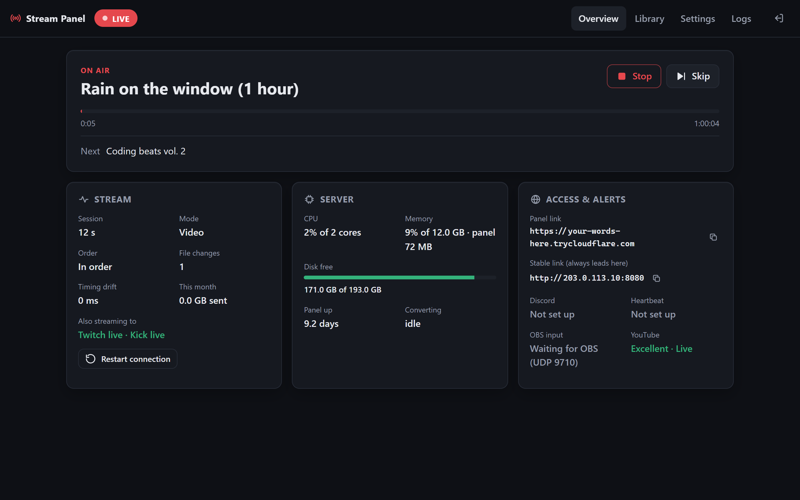
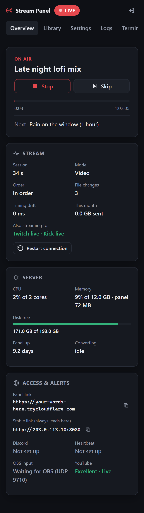
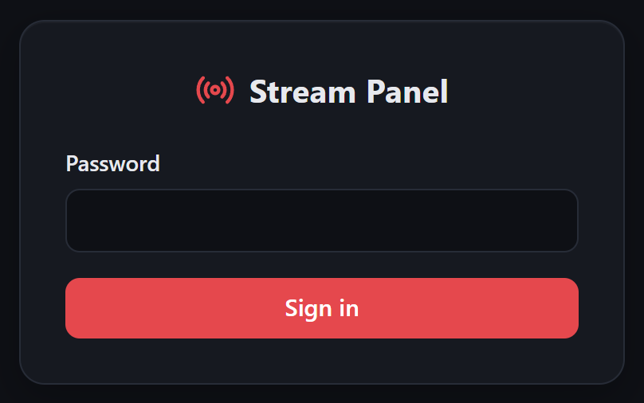
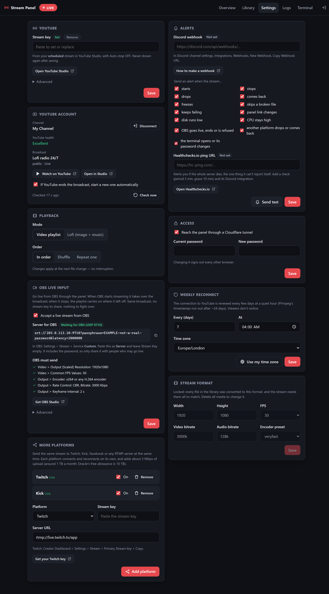
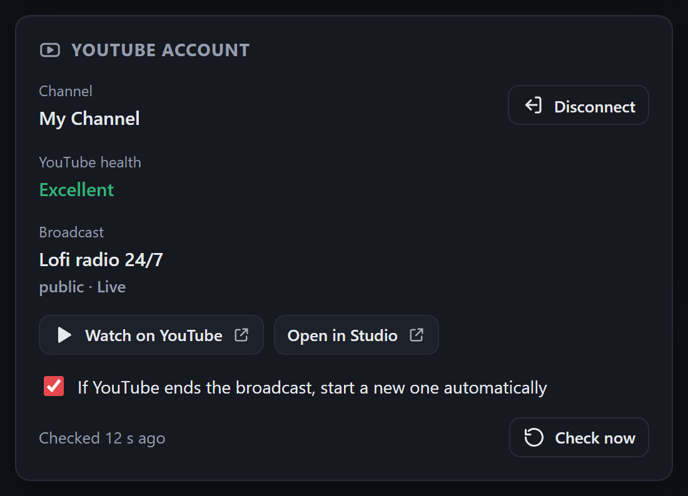
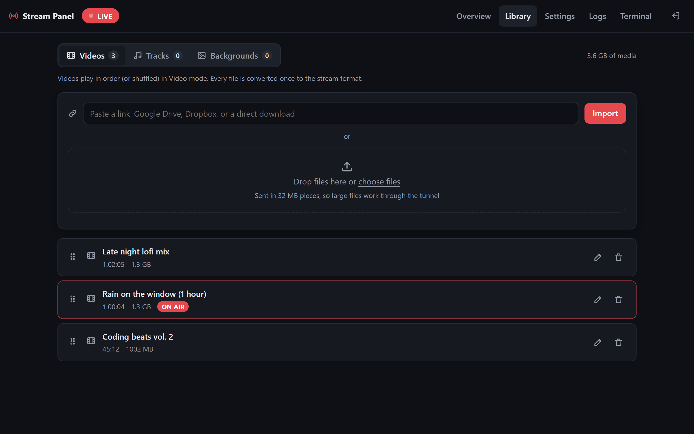
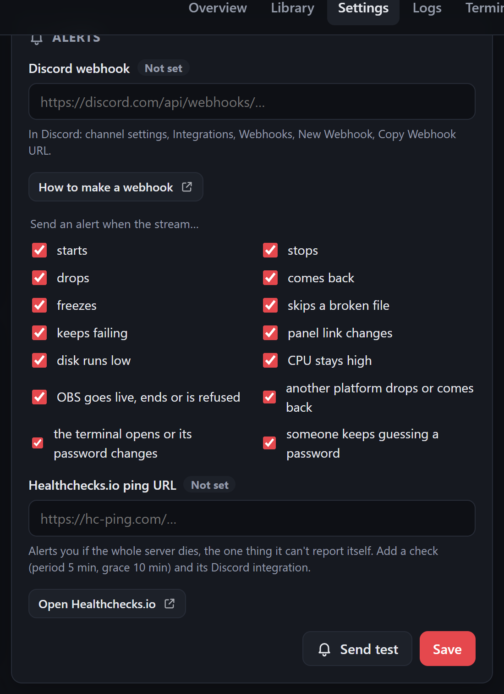
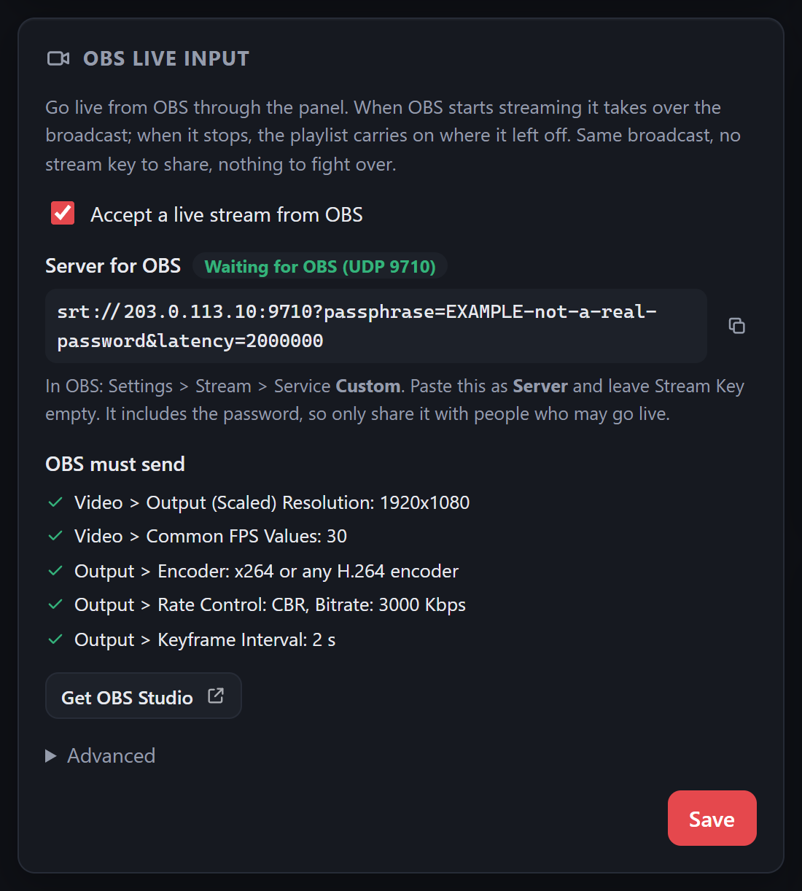
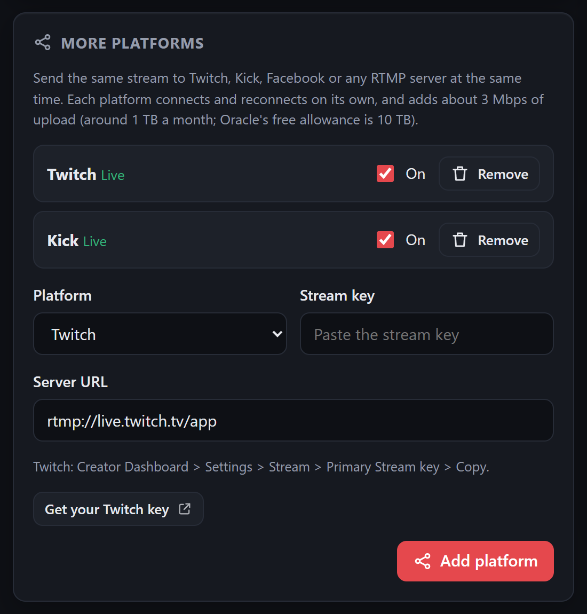

# Stream Panel

Run a **24/7 YouTube live stream** from your own looping videos, or a lofi
image with a music playlist, on one **free Oracle Cloud server**, and control
it from your phone. Go live from OBS through it whenever you like; the
playlist carries on when you stop.



- **Set and forget:** reconnects by itself after network drops, restarts a
  frozen stream, survives server reboots, and resumes the same file at the
  same second.
- **Two modes:** a video playlist (in order, shuffled or repeat-one), or lofi
  (one background image or GIF under a list of music tracks).
- **Edit while live:** add, delete, reorder and skip with no interruption.
- **Uses almost no CPU:** every upload is converted once, so streaming is a
  plain copy (about 1-2% of the server).
- **OBS takeover:** OBS streams into the panel, not straight to YouTube, so
  nobody else needs your stream key.
- **More platforms at once:** the same stream to Twitch, Kick, Facebook or
  any RTMP server, each reconnecting on its own, with almost no extra CPU.
- **Alerts in Discord:** stream started or dropped, back online, YouTube
  health turning Poor, the panel's new link, OBS going live.
- **Optional YouTube connection:** sets up the broadcast for you and shows
  YouTube's own stream health.
- **Private by default:** one password, reached through a Cloudflare link;
  nothing is open to the internet except OBS's port (and only if you turn OBS
  input on).

<p align="center"></p>

## What you need

| | Cost | Needed for |
|-|-|-|
| Oracle Cloud account (Always Free ARM server) | Free (a card is asked for at sign-up) | Running it 24/7 |
| A YouTube channel with live streaming enabled | Free | Streaming |
| A Discord server where you can add a webhook | Free | Alerts (optional, recommended) |
| A Healthchecks.io account | Free | Alerts if the whole server dies (optional) |
| A Google Cloud project | Free | Connect YouTube (optional) |
| OBS Studio 27 or newer | Free | Going live from OBS (optional) |
| Twitch, Kick or other accounts | Free | Streaming to more platforms (optional) |

Any Ubuntu 22.04/24.04 server with systemd works too (x86 or ARM).

## Install

The full walk-through, with every click, is in
**[deploy/SETUP-GUIDE.md](deploy/SETUP-GUIDE.md)**. In short:

1. Create an Oracle **VM.Standard.A1.Flex** (2 OCPU, 12 GB, Ubuntu 24.04,
   200 GB boot volume) and connect with SSH.
2. Get the code onto it and run the installer:
   ```bash
   git clone <this repository> stream-panel
   cd stream-panel
   bash deploy/setup.sh
   ```
   It installs Node.js, FFmpeg and cloudflared, asks for a panel password,
   your stream key, Discord and Healthchecks URLs (Enter skips any), and your
   time zone, then starts the service.
3. The panel's link arrives in Discord (or run
   `journalctl -u stream-panel | grep 'panel URL'`). Open it, sign in, add
   media, press **Start**.

Want to try it first without a server? Run the same installer in Ubuntu on
Windows: [deploy/WSL-REHEARSAL.md](deploy/WSL-REHEARSAL.md).

## Configure



Everything below is in the panel's **Settings** tab. Secrets you paste are
never shown again (only "Set" / "Not set"), and **Remove** deletes them.



### 1. YouTube stream key

YouTube Studio → **Create → Go live** → left sidebar **Manage** →
**Schedule stream**:

1. Pick **Streaming software** (not Webcam). Set a title and visibility.
2. Open the stream: **Key ⌄ → Create new stream key**, copy it.
3. **Stream settings → Additional settings: Auto-start ON, Auto-stop OFF.**
   Auto-stop off is what lets the broadcast survive network drops.
4. Paste the key into **Settings → YouTube → Stream key** and **Save**.

Don't open Studio's **Stream** tab: it creates a separate "go live now"
broadcast that grabs your key. Or skip all of this and use **Connect YouTube**
(section 2), which makes the broadcast for you.

### 2. Connect YouTube (optional)



The panel then shows **YouTube's own health rating** (the one in Studio),
creates the broadcast with the right settings, turns Auto-stop off if it's on,
starts a new broadcast if YouTube ever ends yours, and alerts Discord when
health turns Poor.

Google only lets registered apps ask for YouTube access, so make your own
(free, about 10 minutes), signed in to the account that owns the channel:

1. **console.cloud.google.com** → project menu → **New project** → create
   and select it.
2. Search **YouTube Data API v3** → **Enable**.
3. Search **Google Auth Platform** → **Get started**: any app name, your
   email, Audience **External**, contact email → agree → **Create**.
4. **Branding**: add an app home page and privacy-policy link (this
   repository and its `PRIVACY.md` work) and their domain under **Authorized
   domains** → **Save**.
5. **Audience** → **Publish app** → **Confirm**. (Left in "Testing", Google
   signs the panel out every 7 days.)
6. **Clients** → **Create client** → type **TVs and Limited Input devices** →
   **Create**. Copy the **Client ID** and **Client secret** at once (the
   secret is shown only once).
7. Panel → **Settings → YouTube account** → paste both → **Save** →
   **Connect YouTube**. Enter the code it shows at **google.com/device**,
   choose the channel's account. Google warns the app isn't verified: it's
   yours, so **Advanced → Go to (your app) → Continue**.

The client secret and the sign-in stay in the panel's settings file on your
server. **Disconnect** (or myaccount.google.com/permissions) removes access.

### 3. Add media



- **Paste a link** (Google Drive "Anyone with the link", Dropbox, or any
  direct download): the server downloads it itself, much faster than
  uploading from home. Or **drop files** to upload (sent in 32 MB pieces).
- Each file is converted once to the stream format; long videos take a while
  (progress and time left are shown). Keep your originals elsewhere.
- **Videos** play in Video mode. For **Lofi** mode add one image or GIF under
  **Backgrounds** and music under **Tracks**, then pick Lofi and the
  background in Settings → Playback.
- Drag to reorder; changes apply at the next file without interrupting.
- **Big files** (up to 100 GB) work. While converting, the server needs free
  disk for the file plus its converted copy; the original is deleted after.
  Conversion runs at low priority, so a very long video takes hours but never
  disturbs the stream. Files already in the stream format (1080p30 H.264
  High, constant bitrate 3000 kbps or more, keyframe every 2 s, AAC 44.1 kHz
  stereo) skip conversion entirely.

### 4. Alerts



- **Discord**: your server → channel settings → **Integrations → Webhooks →
  New Webhook → Copy Webhook URL** → paste → **Send test**.
- **Healthchecks.io**: **Add Check** (period 5 min, grace 10 min) → paste its
  ping URL. In Healthchecks add the Discord integration: you'll hear about it
  if the whole server goes down.

### 5. Go live from OBS (optional)



1. Oracle console → your VCN → **Security Lists** → **Add Ingress Rule**:
   source `0.0.0.0/0`, protocol **UDP**, port **9710**.
2. Panel → **OBS live input** → tick **Accept a live stream from OBS** →
   **Save** → copy the **Server for OBS** address. It contains the password;
   **New password** (under Advanced) locks the old address out.
3. OBS → Settings → **Stream**: Service **Custom...**, Server = that address,
   Stream Key empty. **Video**: 1920x1080, 30 FPS. **Output** (Advanced):
   x264, CBR, 3000 Kbps, Keyframe Interval 2.
4. **Start Streaming** in OBS: within seconds the panel says *Live from OBS*.
   Stop in OBS and the playlist carries on where it was cut.

### 6. Stream to more platforms (optional)



1. Get the platform's stream key:
   - **Twitch**: Creator Dashboard → **Settings → Stream** → Primary Stream
     key → **Copy**.
   - **Kick**: Dashboard → **Stream URL & Key**. Kick emails a 6-digit
     security code before it shows the key. Copy only the **Stream Key**:
     keep the server URL the panel fills in (Kick's page shows it without
     `/app` at the end; the filled-in form is the one tested with Kick).
   - **Facebook**: Live Producer → **Streaming software** → use a persistent
     stream key.
   - **Anything else**: its RTMP or RTMPS server URL and stream key.
2. Panel → **Settings → More platforms** → choose the platform, paste the key
   → **Add platform**. The server URL is filled in for Twitch, Kick and
   Facebook; change it only for **Other**. It joins within a few seconds.
3. Each platform has its own **On** switch and status (Live, Connecting,
   Retrying). A platform that fails never affects YouTube or the others, and
   reconnects by itself; Discord tells you when one drops and comes back.

Each platform uploads another ~3 Mbps (about 1 TB a month; Oracle's free
allowance is 10 TB a month). Extra platforms follow the main stream: when the
panel's stream is stopped, they stop too. OBS takeover reaches every platform.
Check each platform's rules on 24/7 pre-recorded streams before leaving it on.

## Keep your keys private

- All secrets (stream keys, Discord and Healthchecks URLs, the OBS password,
  the Google client secret and sign-in) live in **one file on the server**,
  `data/config.json`, readable only by the service's user (mode 600). The
  panel never sends them back to the browser.
- `data/` and `media/` are in `.gitignore`: **never commit them**, and don't
  paste keys into issues, screenshots or chats.
- Logs and Discord messages have secrets masked automatically.
- If a stream key leaks: Studio → **Key → Reset**, then paste the new one. If
  a Discord webhook leaks: delete it in Discord and make a new one. If the OBS
  address leaks: **New password**.
- The panel itself has one password (`npm run set-password` on the server
  resets it) and locks out repeated wrong guesses.

## Day to day

| Task | How |
|-|-|
| Find the panel link | Discord, or `journalctl -u stream-panel \| grep 'panel URL'` |
| See what's happening | Panel → **Logs**, or `journalctl -u stream-panel -f` |
| Restart everything | `sudo systemctl restart stream-panel` (resumes where it was) |
| Update to a new version | `bash deploy/update.sh` |
| Reset the panel password | `cd stream-panel && npm run set-password` |

More in the guide's [Troubleshooting](deploy/SETUP-GUIDE.md#troubleshooting).

## How it works

Every upload is converted **once** to a fixed profile (1080p30 H.264 at a
constant bitrate, AAC). Node feeds one file at a time into **one**
long-running FFmpeg that holds the YouTube connection, joining the files
cleanly in between, so playlist edits, skips and shuffle happen live. A
supervisor reconnects within seconds, restarts a frozen stream, and does a
clean weekly reconnect that viewers don't notice.

## Development

Needs Node 22+ and FFmpeg/ffprobe on `PATH` (tested on FFmpeg 9.0).

```bash
npm install
npm run set-password
npm start                      # http://127.0.0.1:3000
```

Stream to a local file instead of YouTube while developing:

```powershell
$env:STREAM_DEST = "C:\temp\out-%d.flv"; $env:TUNNEL = "0"; npm start
```

Environment variables (all optional; they override `data/config.json`
without writing to it):

| Variable | Effect |
|-|-|
| `STREAM_KEY` | YouTube stream key |
| `DISCORD_WEBHOOK_URL` | Discord alerts |
| `HEALTHCHECK_URL` | Healthchecks.io ping URL |
| `STREAM_DEST` | Stream to this file (`%d` = session number) or RTMP URL instead of YouTube |
| `TUNNEL` | `0` disables the Cloudflare tunnel |
| `PORT`, `HOST` | Listen address (default `127.0.0.1:3000`) |
| `DATA_DIR`, `MEDIA_DIR` | Where config/library and media live (default `data/`, `media/`) |
| `FFMPEG`, `FFPROBE` | Paths to the binaries |

Settings from the command line: `node cli.js set mode lofi`, or for secrets
`printf '%s\n' "$KEY" | node cli.js set youtube.streamKey --stdin`.

